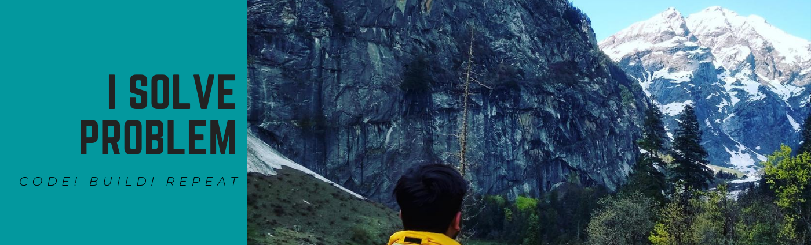

# Hi, I am Maaz Abdullah 👋💻🌍

Hey y’all, I’m Maaz! I’m a Senior Member of Technical Staff at Nielsen in Bangalore, India. Born and raised in UP, I moved down to study Computer Engineering at Aligarh Muslim University. Over 7+ years, I’ve worked across backend architecture, identity and access management, high-performance API gateways, and distributed systems. At Nielsen, I architected a Node.js API Gateway that centralizes Okta-based OIDC authentication and RBAC (cutting p90 latency by 83%) and built a multi-tenant MCP Security Gateway to secure internal MCP servers. Earlier in my career, I worked on SAP SuccessFactors, building alumni portals and notification services. Apart from all this, I’m really passionate about problem solving, mathematics, travelling, business, and exploring new places!

## Find me around the web 🌎:

- Learning in public on <a href="https://maazabdullah.netlify.app/">Maaz Abdullah</a> :globe_with_meridians:
- Follow me on <a href="https://github.com/maaz1996">Github</a> :octocat:
- Find me on <a href="https://www.linkedin.com/in/maaz-abdullah/">LinkedIn</a> 💼
